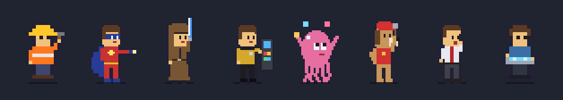

# Agent Pals

Little pixel-art characters that live above your Windows taskbar and act out what your coding
agents are doing: working, thinking, waiting for you, finishing up, or calling in help. Works
with **Claude Code** and **Codex**.



## Download

### [⬇ Download Agent Pals for Windows (AgentPals.msi)](https://github.com/0xAHA/agent-pals/releases/latest/download/AgentPals.msi)

Windows 10 or 11. Installs for your user only, so no admin rights are needed. Release notes and
older versions are on the [Releases page](https://github.com/0xAHA/agent-pals/releases).

> The installer isn't code-signed yet, so Windows SmartScreen may warn about it. Choose
> **More info → Run anyway**. Each release publishes `AgentPals.msi.sha256` if you want to check
> the download.

## What you'll see

Each agent session gets its own pal. Hover over the tray icon for a summary, including which
project folders need you. A pal that has been idle for two minutes steps away, and comes back
as the same character when its agent does something.

| The pal is… | When the agent is… |
| --- | --- |
| hammering, typing, swinging a blade… | running a tool |
| showing `…` | thinking between steps |
| bouncing a `!` | waiting for you (a permission prompt or a question) |
| jumping with a `✓` | done with its turn |
| dozing with `Z` | idle for a while |

**Subagents get pals of their own.** When an agent starts a subagent, a new pal appears beside
its parent, says hello, and walks to its own spot. It animates with that subagent's own
activity, walks back to report when it finishes, and then leaves.

**Agents that message each other visibly talk.** The sender walks over to the recipient, they
chat for a moment, and the sender walks back.

### Characters

Pick a family from the tray menu, or **random** (the default) for a mix. Random never repeats a
family until every one is on screen, and a pal keeps its character for as long as it's around.
Colours vary from pal to pal, and each family has several work and idle animations so a group
never moves in lockstep.

- **heroes**: caped crusaders; energy blasts, punch combos, boulder lifting
- **space-knights**: hooded robes and energy blades
- **starship-crew**: duty uniforms, scanners, consoles and communicators
- **undersea**: an octopus who types, juggles and reads
- **rescue-pups**: digging, binoculars, walkie-talkies
- **paper-co**: shirt and tie, stamping paperwork and taking calls
- **office** and **construction**: the original, smaller crew

## Setup

Run the installer. It:

- installs to `%LOCALAPPDATA%\Programs\AgentPals` and adds a Start menu shortcut
- starts Agent Pals now and whenever you sign in (untick **Start with Windows** in the tray to stop that)
- adds its hooks to Claude Code's `~/.claude/settings.json`, keeping your original as
  `settings.json.agent-pals.bak`
- if Codex is installed, adds its hooks to `~/.codex/hooks.json` the same way

Any other hooks you have are left alone, and uninstalling removes Agent Pals' hooks again.

- **Claude Code:** start a new session and your pal appears.
- **Codex:** Codex only runs hooks you've approved. Run `/hooks` in Codex once and trust the
  Agent Pals entries, then start a new session. (Codex asks again after an update that changes
  the hook command.)

## The tray menu

Right-click the pal icon in the notification area.

| Item | Does |
| --- | --- |
| Show pals | Hide or show the strip without quitting |
| Scale | Size of the pals. **2x** and **4x** are pixel-perfect |
| Position | Left, middle or right of the taskbar. Pals line up from that end and come and go by its edge |
| Theme | A character family, or **random** |
| Start with Windows | Start at sign-in |
| Updates | Check now, install an available update, or choose how updates work (below) |
| Reload profiles and themes | Pick up edits to `profiles/` and `themes/` without restarting |
| Open config folder | Where `config.json`, `profiles/` and `themes/` live |

### Updates

Agent Pals checks this repository's releases shortly after it starts and every six hours after
that. You choose what happens when there's a new version:

- **Tell me about updates** (default): the Updates menu and tray tooltip offer it, and you click to install.
- **Install updates automatically**: installs once no agent is busy, so your sessions aren't interrupted.
- **Don't check**: no network requests at all.

An update is downloaded over HTTPS and its SHA-256 is checked against the one published with the
release before anything runs. It then upgrades in place and restarts, keeping your settings.

## Configuration

`config.json` in the install folder is written when you change something in the tray. You can
also edit it by hand; quit and restart the app afterwards.

| Key | Default | Meaning |
| --- | --- | --- |
| `theme` | `"random"` | A theme folder name, `local/<name>` for your own, or `random` |
| `scale` | `2` | Screen pixels per sprite pixel-block |
| `position` | `"right"` | `left`, `center` or `right` along the top of the taskbar |
| `fps` | `10` | Animation frame rate (2 to 30) |
| `max_agents` | `8` | Most pals on screen at once |
| `strip_width` | `160` | Width of the strip, in sprite pixels |
| `margin_px` | `8` | Gap between the strip and the screen edge (left or right placement) |
| `visible` | `true` | Same as **Show pals** |
| `updates` | `"notify"` | `notify`, `auto` or `off` |
| `hide_idle_secs` | `120` | Seconds idle before a pal steps away; `0` keeps it on screen |

## Privacy

Nothing about your code or conversations leaves your machine, and very little even reaches the
app. The hook relay forwards only an allow-list of fields: the event name, tool name, session
and subagent IDs, the working folder and, for messages between agents, the recipient. Prompts,
replies, file contents, commands and message text are dropped inside the relay. It talks to the
app over a local named pipe that refuses remote connections.

The only network traffic is the update check to `api.github.com` and, when you install one, the
update itself. **Don't check** turns that off.

## How it works

```text
Claude Code / Codex ──hook──▶ hook-relay.exe ──named pipe──▶ agent-pals.exe ──▶ overlay above the taskbar
```

- **`hook-relay.exe`** runs once per hook event. It slims the payload and forwards it, then
  always exits quietly and successfully, so it can never block or break your agent.
- **`profiles/*.json`** map events to what a pal does. `claude-code.json` drives Claude Code. A
  profile for another agent is a drop-in file; `codex.json` shows how little one needs.
- **`themes/<name>/`** each hold a `sheet.png` of frames and a `theme.json` describing them.

### Setting up the hooks yourself

The installer does this for you. If you build from source, run
`hook-relay.exe --install-claude-hooks` and/or `hook-relay.exe --install-codex-hooks` (the
`--uninstall-…` forms take them out again). Or copy
[`examples/claude-code-settings.json`](examples/claude-code-settings.json) /
[`examples/codex-hooks.json`](examples/codex-hooks.json) and change the path.

Use **forward slashes** in the path: Claude Code runs hooks through Git Bash on Windows, which
treats backslashes as escape characters.

## Make your own characters

A theme is a folder in `themes/` containing:

- **`sheet.png`**: frames facing right, one animation per row
- **`theme.json`**, like this:

```json
{
  "name": "my-crew",
  "frame_w": 32, "frame_h": 40, "density": 2,
  "anims": {
    "idle": { "row": 0, "frames": 4, "fps": 3 },
    "work": { "row": 3, "frames": 4, "fps": 6 },
    "work_2": { "row": 8, "frames": 4, "fps": 6 }
  },
  "swaps": [
    { "key": "#c83232", "choices": ["#c83232", "#2850c8", "#2d9646"] }
  ]
}
```

- **Animations:** `idle` is required. The app also uses `walk`, `think`, `work`, `wait`, `talk`
  and `done`, falling back to `idle` for any that are missing.
- **Variants:** `work_2`, `work_3` and so on are alternates. Each pal picks one, and picks again
  every so often.
- **`density`:** sheet pixels per sprite pixel. At `2`, a 32×40 frame fills the same 16×20 slot
  as the classic themes at twice the detail, so both kinds mix in random mode.
- **`swaps`:** exact colours repainted per pal from `choices`, so a crew doesn't look identical.
  Don't use a key colour for anything that should keep its colour.

Put themes you don't want in the repository in `themes/local/<name>/` (git ignores that folder).
They appear in the menu as `local/<name>` and join random mode. That's the place for fan art of
characters you don't own the rights to.

The bundled families are generated by `tools/gen_hires_sprites.py`, where each family is a small
Python class. It's a good starting point for a new one.

## Building from source

You need Rust (stable) and the Windows SDK (for `rc.exe`, which embeds the icon). The installer
also needs the [WiX](https://wixtoolset.org) .NET tool, and Python with Pillow is only needed to
regenerate art.

```powershell
cargo test --release                  # unit tests
cargo test --release -- --ignored     # plus network tests for the updater's HTTPS client
cargo build --release                 # target\release\agent-pals.exe and hook-relay.exe

.\tools\package.ps1                   # portable folder: dist\agent-pals\
.\tools\build-installer.ps1           # installer: dist\AgentPals-<version>.msi

python tools\gen_hires_sprites.py     # regenerate the six hi-res families
python tools\gen_icon.py              # regenerate assets\agent-pals.ico
python tools\gen_demo.py              # regenerate assets\demo.gif
```

WiX setup, once: `dotnet tool install --global wix --version 5.0.2`, then
`wix extension add --global WixToolset.Util.wixext/5.0.2`.

**Debugging hooks:** create an empty file named `debug-hooks` next to `hook-relay.exe` and every
raw payload is appended to `hook-debug.jsonl` beside it. That file includes prompts and file
contents, so delete the flag and the log when you're done.

### Releasing

1. Bump `version` in `Cargo.toml` and add a `## [x.y.z]` section to `CHANGELOG.md`.
2. Commit, then tag and push: `git tag vx.y.z && git push origin vx.y.z`.

The release workflow tests, builds the installer and publishes it with its checksum, using that
CHANGELOG section as the notes. Installed copies pick the update up on their next check.

## License

[MIT](LICENSE)
